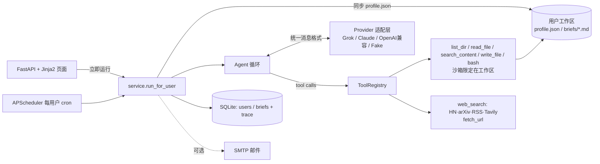

# 每日 AI 新闻助手 Agent

跨赴科技 Agent 开发实习生笔试 · 选项 A。Python 实现，Agent 循环手写：调用哪个工具、调几次、什么时候停，都由 LLM 自己决定，代码里没有写死的线性流程。按用户的订阅偏好（话题、关键词）每天整理 AI 新闻简报，保存到历史记录，邮件推送可选。

详细设计报告见 [docs/DESIGN.md](docs/DESIGN.md)。

## 5 分钟快速开始

```bash
git clone <repo> && cd ai-news-agent
cp .env.example .env            # 填一个 provider 的 key（见下表）；不填 key 也可以用 fake 模式演示
./run.sh                        # 自动建 venv、装依赖、启动 http://localhost:8000
```

不想配 key：`LLM_PROVIDER=fake ./run.sh` 启动离线“假模型”，它也会按顺序调用真实工具（读画像 → 列历史 → 搜 HN → 去重 → 写简报），可以走完整个流程。

打开 http://localhost:8000 → 填昵称和邮箱 → 设置话题、关键词、每日时间 → 点「立即生成今日简报」→ 刷新页面，查看简报和 Agent trace。

| LLM_PROVIDER | 需要的环境变量 | 说明 |
|---|---|---|
| `grok` | `XAI_API_KEY`，`LLM_MODEL`（如 `grok-4`） | xAI，OpenAI 兼容接口 `https://api.x.ai/v1`，用 `openai` SDK |
| `claude` | `ANTHROPIC_API_KEY`，`LLM_MODEL`（如 `claude-sonnet-4-5`） | Anthropic Messages API，原生 `tool_use`/`tool_result`，用 `anthropic` SDK |
| `openai` | `LLM_API_KEY`，`LLM_BASE_URL`，`LLM_MODEL` | 任意 OpenAI 兼容接口：OpenAI / DeepSeek / Kimi |
| `fake` | 无 | 离线演示 / 测试 |

其他：`make test` 跑测试，`TAVILY_API_KEY` 可选（配了就用 Tavily 搜索），`SMTP_*` 是邮件推送（默认关闭），建表 SQL 在 `schema.sql`（启动时也会自动建表）。

## 架构



## 目录

```
app/agent.py          手写 Agent 循环 + system prompt
app/llm/              provider 适配层（base / providers / demo 假模型）
app/tools/            sandbox、5 个基础工具、新闻工具、注册表（JSON Schema）
app/service.py        一次运行：同步画像 → Agent → 记录索引/trace → 推送
app/scheduler.py      APScheduler 每用户每日任务
app/main.py, templates/  前端页面
tests/                沙箱逃逸、Agent 循环（假 LLM）、适配层转换、Web 流程
```

## 设计决策（摘要，详见 [DESIGN.md](docs/DESIGN.md)）

- **输出与渲染**：每次运行写独立的 `runs/<日期>/<run_id>.md`，确认本次真的写了才算成功并同步到 `briefs/` 去重；简报 HTML 用 `nh3` 白名单清理防 XSS；`web_search` 的 `days` 对所有来源生效。
- **代码审查记录**：8 个问题的发现与修复见 [docs/REVIEW.md](docs/REVIEW.md)。

- **为什么手写循环、不用 LangGraph**：核心逻辑约 80 行，每一步都看得见、测得了；多 provider 的差异收在适配层里，不依赖框架的抽象。题目要求的“模型自己决策”就是一个 while 循环加工具分发。
- **模型怎么决定停**：某一轮模型不再返回 tool call，就算完成。另有三道保护：`AGENT_MAX_STEPS` 步数上限（倒数第二步会提示“马上收尾”），同一个调用重复 3 次就拒绝执行，LLM 报错时干净退出。
- **bash 安全**：命令白名单（只读类命令）+ 每个命令的选项白名单（拒绝 `sort -o`、`find -exec`、长选项等），禁止管道、重定向、`;`、`$()`；不经过 shell 直接执行，cwd 固定在工作区，每个文件操作数（含 basename 软链）都要过沙箱检查，有 10 秒超时，环境变量清空。文件工具都用 `resolve()` 检查路径，防住 `..` 和符号链接逃逸。
- **去重**：模型用 `search_content` 拿 URL 或标题去 `briefs/` 里查，命中了就丢掉。简单、可解释，也不需要向量库。
- **成本控制**：工具输出截断到 6000 字符、`read_file` 最多 2 万字符，搜索结果只返回标题、链接、日期这几行，prompt 里建议 4 到 10 次调用，每次运行记录 token 用量。
- **失败处理**：工具异常转成 `ERROR: ...` 回传给模型，让它自己纠正；单个新闻来源失败不影响其他来源；推送失败不影响简报落盘；每个用户同一时间只跑一个任务。
