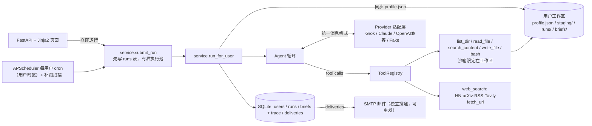

# 每日 AI 新闻助手 Agent

跨赴科技 Agent 开发实习生笔试 · 选项 A。Python 实现，Agent 循环手写：调用哪个工具、调几次、什么时候停，都由 LLM 自己决定，代码里没有写死的线性流程。按用户的订阅偏好（话题、关键词）每天整理 AI 新闻简报，保存到历史记录，邮件推送可选。

详细设计报告见 [docs/DESIGN.md](docs/DESIGN.md)，设计评审见 [docs/DESIGN_REVIEW.md](docs/DESIGN_REVIEW.md)。

需要 **Python 3.11 或以上**。CI 在 3.11 和 3.12 上跑测试，Ruff 的 `target-version` 是 `py311`。本机最近一次 `make ci` 使用 Python 3.14。

## 5 分钟快速开始

```bash
git clone https://github.com/kayzenline/ai-news-agent.git && cd ai-news-agent
cp .env.example .env            # 填一个 provider 的 key（见下表）；不填 key 也可以用 fake 模式演示
./run.sh                        # 自动建 venv、装依赖、启动 http://127.0.0.1:8000（HOST 可改，默认只监听本机）
```

不想配 key：`LLM_PROVIDER=fake ./run.sh` 用脚本化“假模型”代替真实 LLM（读画像 → 列历史 → 搜 HN → 去重 → 写简报）。它**只免模型 API，不是全离线**：`web_search` 仍会真实请求 Hacker News；测试里替换了搜索工具才做到离线。脚本顺序是写死的，不能用来证明模型自主性。“5 分钟启动”尚未在干净环境复验，依赖也未锁版本。

打开 http://127.0.0.1:8000 → 填昵称和邮箱 → 设置话题、关键词、时区、每日开始生成时间 → 点「立即生成今日简报」→ 页面自动显示运行状态和完成结果，无需刷新 → 查看简报、投递状态和 Agent trace。

用户页在任务运行时每 2 秒查询一次，空闲时每 10 秒检查新的定时任务；成功、无新增、失败或中断会自动显示，并更新历史简报和查看链接。生成按钮采用异步提交，自动更新不会清空尚未保存的偏好输入。连接暂时中断时提示重连，不将任务误判为失败；需要启用 JavaScript。脚本也可使用 `GET /users/<uid>/activity` 或 `GET /runs/<run_id>` 查询状态。

> 没有登录鉴权：邮箱只是身份标识，不是认证。不要把服务开放到局域网或公网（见 DESIGN §12）。

| LLM_PROVIDER | 需要的环境变量 | 说明 |
|---|---|---|
| `grok` | `XAI_API_KEY`，`LLM_MODEL`（如 `grok-4`） | xAI，OpenAI 兼容接口 `https://api.x.ai/v1`，用 `openai` SDK |
| `claude` | `ANTHROPIC_API_KEY`，`LLM_MODEL`（如 `claude-sonnet-4-5`） | Anthropic Messages API，原生 `tool_use`/`tool_result`，用 `anthropic` SDK |
| `openai` | `LLM_API_KEY`，`LLM_BASE_URL`，`LLM_MODEL` | 任意 OpenAI 兼容接口：OpenAI / DeepSeek / Kimi |
| `fake` | 无模型密钥 | 免模型 API，不是全离线：`web_search` 仍请求 Hacker News；测试里替换搜索工具才离线 |

### 使用 OpenAI 兼容服务做真实测试

在本机 `.env` 设置以下四项（使用服务商提供的 API 地址和准确模型名）：

```dotenv
LLM_PROVIDER=openai
LLM_API_KEY=在本机填入密钥
LLM_BASE_URL=https://你的服务商地址/v1
LLM_MODEL=服务商提供的模型名
```

`LLM_BASE_URL` 是服务商给出的 API 基础地址，不是网页聊天地址，也不要自行追加 `/chat/completions`。本项目读取的是 `LLM_API_KEY`；仅设置 `OPENAI_API_KEY` 不会替代它。密钥只保存在本机 `.env`（Git 已忽略），不用发到聊天或页面；值直接填写，不加引号。

DeepSeek 官方 V4.1 Flash 的配置如下，API 调用名是 `deepseek-flash`（见 [官方说明](https://api-docs.deepseek.com/)）：

```dotenv
LLM_PROVIDER=openai
LLM_API_KEY=在本机填入DeepSeek密钥
LLM_BASE_URL=https://api.deepseek.com
LLM_MODEL=deepseek-flash
```

当前适配器对 DeepSeek 官方地址使用非思考模式，避免多轮工具调用需要回传 `reasoning_content` 的兼容问题（见 [官方思考模式说明](https://api-docs.deepseek.com/guides/thinking_mode/)）。如果密钥来自第三方平台，应使用该平台的 API 地址和模型名；该参数不会自动发送到其他平台。

先运行 `make check-llm`。它只调用一次模型，检查鉴权、响应和工具调用，不搜索新闻、不发送邮件；有少量模型用量。这个检查会实际发送 `tools`、`temperature` 和 `max_tokens`，服务商宣称兼容不代表每个模型都接受这些参数。

检查通过后，先在旧服务终端按 Ctrl+C，再用 `LLM_PROVIDER=openai SMTP_ENABLED=0 ./run.sh` 重启，打开页面生成简报。之前运行中的 fake 服务不会因修改 `.env` 自动切换；进程环境变量优先于 `.env`。

其他：`make test` 跑测试；`TAVILY_API_KEY` 可选；`SMTP_*` 是邮件推送（默认关闭；用户开了邮件但服务没配 SMTP 时，投递状态显示 `not_configured`）；`DEFAULT_TIMEZONE`、`CATCHUP_HOURS`、`MAX_CONCURRENT_RUNS`、`AGENT_MAX_TOOL_CALLS`、`AGENT_RUN_DEADLINE_S` 见 `.env.example`。建表 SQL 在 `schema.sql`；启动时 `create_all` 建缺失表并给旧库补缺失的可空列，这不是完整迁移。

## 架构



## 目录

```
app/agent.py          手写 Agent 循环 + system prompt
app/llm/              provider 适配层（base / providers / demo 假模型）
app/tools/            sandbox、5 个基础工具、新闻工具、注册表（JSON Schema）
app/service.py        一次运行：同步画像 → Agent → 记录索引/trace → 推送
app/scheduler.py      APScheduler 每用户每日任务
app/main.py, templates/  前端页面
tests/                沙箱逃逸、Agent 循环（假 LLM）、适配层转换、Web 流程
```

## 设计决策（摘要，详见 [DESIGN.md](docs/DESIGN.md)）

- **输出、发布与历史**：模型只能写本轮 `staging/<run_id>/`（画像、`runs/`、`briefs/` 对模型只读）。校验通过后由 Service 渲染后原子改名发布到 `runs/<日期>/<run_id>.md`，并**追加**一份到 `briefs/<日期>/<run_id>.md` 作去重历史，从不覆盖旧记录（同日 A → B → A 也查得到 A）。简报 HTML 用 `nh3` 白名单清理防 XSS。
- **结构化内容契约**：工具层给本轮每条 `web_search` 结果和 `fetch_url` 页面分配 `ev_NNN` 证据 ID（保存来源、标题、URL、发布日期、抓取时间、摘录、hash）。模型只写 `staging/<run_id>/draft.json`（0–10 条，每条标题/话题/摘要/推荐理由 + `evidence_ids`，文本里不许有 URL），**不写 Markdown**。Service 校验 schema、证据 ID、同源重复和已发布历史（同一来源再发必须标 `change_type=update` 并给 `delta`），错误回传模型修订（最多 2 次），仍不过记 `validation_failed`；通过后由 Service 渲染 Markdown（链接只来自证据库），并在简报旁保存 `<run_id>.draft.json` 和 `<run_id>.evidence.json`。0 条记 `no_news`，不发邮件。程序只能证明“引用来自本轮工具结果”，不能证明摘要事实正确。
- **运行与状态**：手动和定时都走 `submit_run`，先写 `runs` 表再执行；同用户已有任务返回同一个 run；全局并发和排队有上限；任何异常都落到 run 终态，重启时遗留任务标 `interrupted`。
- **时区与补跑**：每用户 IANA 时区，业务日期按用户时区算；定时任务同日只有一个逻辑 run（幂等键），停机错过的在 `CATCHUP_HOURS` 窗口内补一次，DST 跳过的时刻顺延到当天首个有效时刻。
- **投递**：`deliveries` 表独立记录 `not_configured/pending/sending/sent/failed/unknown`，失败可重发原正文，不重跑模型；不承诺 exactly-once。
- **网络安全**：`fetch_url` 拒绝内网/保留地址、凭据 URL 和非 80/443 端口，重定向逐跳重验，响应最多读 2 MB。仍有 DNS rebinding 窗口，开放服务前需出口网络规则。
- **代码审查记录**：8 个问题的发现与修复见 [docs/REVIEW.md](docs/REVIEW.md)。

- **为什么手写循环、不用 LangGraph**：核心逻辑约 80 行，每一步都看得见、测得了；多 provider 的差异收在适配层里，不依赖框架的抽象。题目要求的“模型自己决策”就是一个 while 循环加工具分发。
- **模型怎么决定停**：某一轮模型不再返回 tool call，就算完成（再过内容校验）。保护：`AGENT_MAX_STEPS` 轮数上限（倒数第二轮提示收尾）、`AGENT_MAX_TOOL_CALLS` 总工具调用上限、`AGENT_RUN_DEADLINE_S` 软期限（只在每轮/每次调用前检查，不能中断进行中的同步调用）、参数规范化后同一调用第 3 次拒绝执行（`fetch_url` 按规范 URL、忽略末尾斜杠判重；本轮已失败的网络调用直接返回缓存错误、不再请求）、连续 3 轮工具全失败提示收尾、5 轮提前停止（`tool_failures`）、LLM 报错时干净退出。循环没有固定业务步骤，但 Prompt 给了策略建议（如先读画像）。
- **bash 安全**：命令白名单（只读类命令）+ 每个命令的选项白名单（拒绝 `sort -o`、`find -exec`、长选项等），禁止管道、重定向、`;`、`$()`；不经过 shell 直接执行，cwd 固定在工作区，每个文件操作数（含 basename 软链）都要过沙箱检查，有 10 秒超时，环境变量只保留 `PATH`/`LANG`。`mkdir` 只能在本轮 staging 下。这是应用层限制，不是 OS 级隔离。文件工具都用 `resolve()` 检查路径，防住 `..` 和符号链接逃逸。
- **去重**：模型用 `search_content` 拿 URL 或标题去 `briefs/`（完整的追加式历史）里查，命中了就丢掉。只做字面匹配；同一事件换 URL 的识别（事件更新雷达）是下一阶段。
- **成本控制**：工具输出截断到 6000 字符、`read_file` 最多 2 万字符，搜索结果只返回标题、链接、日期这几行，prompt 里建议 4 到 10 次调用，每次运行记录 token 用量。
- **失败处理**：工具异常转成 `ERROR: ...` 回传给模型，让它自己纠正；单个新闻来源（包括单个 RSS feed）失败会写进结果的 `errors:` 行；推送失败只影响投递状态；每个用户同一时间只跑一个任务。

## 许可

代码以 [MIT License](LICENSE) 授权。仓库可以公开浏览，并不自动允许他人使用、修改或再分发；这些权利以 `LICENSE` 为准。
