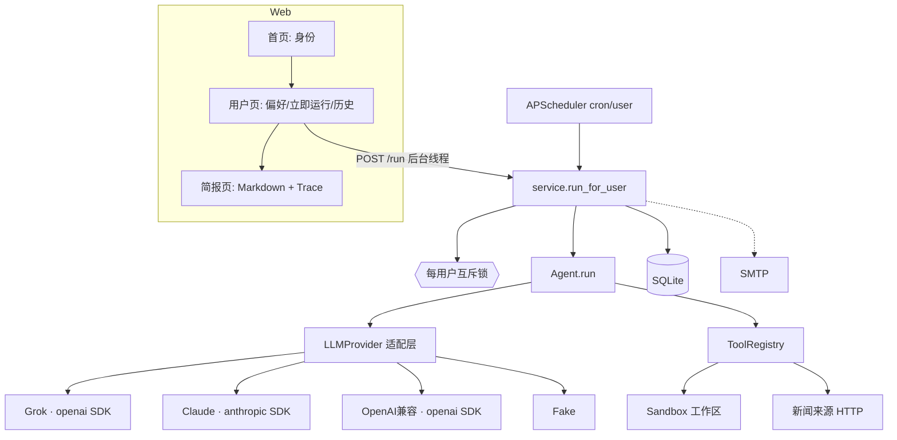
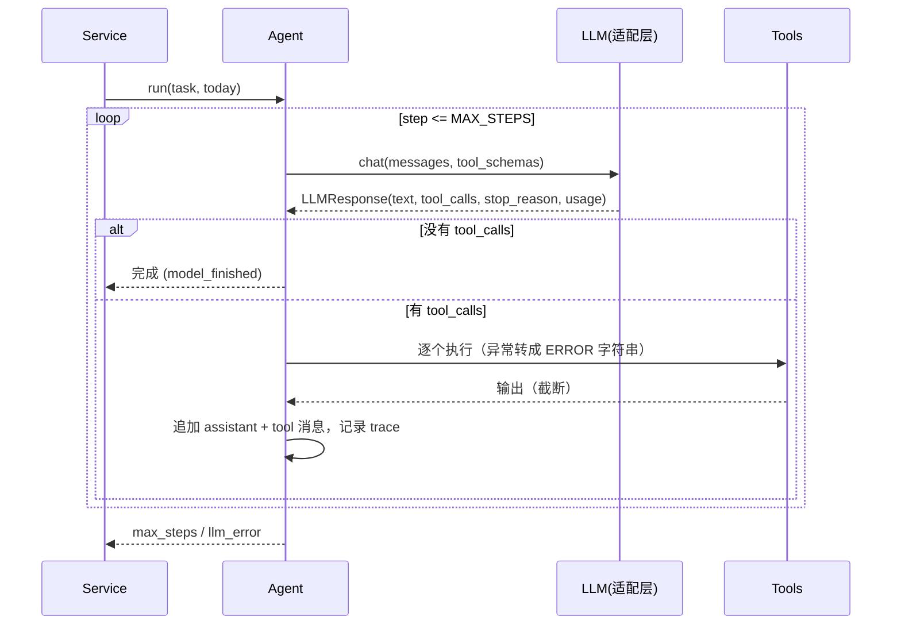

# 设计报告：每日 AI 新闻助手 Agent

## 1. 目标与需求对照

| 题目要求 | 实现位置 |
|---|---|
| 每天自动整理 AI 新闻简报并推送 | `scheduler.py`（APScheduler 每个用户一个 cron）+ `service.py`（保存历史，邮件可选） |
| 按偏好订阅（话题、关键词）筛选 | `users.topics/keywords` → 写进工作区 `profile.json` → 模型用 `read_file` 读取后自己构造查询 |
| 新闻来源可让模型自己搜 | `web_search`（HN Algolia / arXiv / RSS / Tavily）+ `fetch_url`，来源和查询词都由模型选 |
| 至少 5 个工具 | `list_dir / read_file / search_content / write_file / bash`，另加 `web_search / fetch_url` |
| 简单前端 | `main.py` + Jinja2：填身份、设偏好、看历史和 trace、立即运行 |
| 工具顺序由 LLM 决定 | `agent.py` 的循环只负责分发工具调用，没有任何写死的步骤 |
| Git 历史、5 分钟跑起来、密钥走环境变量、建表 | 增量提交；`run.sh`；`.env.example`；`schema.sql` 加启动时 `create_all` |

## 2. 架构

### Agent 循环时序

## 3. Provider 抽象

- 内部统一用 OpenAI 风格的消息：`assistant.tool_calls=[{id,name,arguments}]`、`tool.tool_call_id`。
- `LLMResponse` 把各家返回统一成 `text / tool_calls / stop_reason(tool_use|end|length) / usage`。
- **OpenAI 兼容（Grok、OpenAI、DeepSeek、Kimi）**：用 `openai` SDK，只是 `base_url` 不同；`finish_reason=tool_calls` 映射成 `tool_use`。
- **Claude**：system 单独作为参数传；assistant 的 tool_calls 转成 `tool_use` 块；连续的 tool 消息合并到同一条 user 消息里的多个 `tool_result` 块（Anthropic 要求这样），以 `ERROR` 开头的结果标 `is_error`；`stop_reason` 的 `end_turn/tool_use/max_tokens` 做归一化。
- 工具 schema 只定义一份（OpenAI function 格式），Claude 适配器转成 `input_schema`。
- 加新 provider 只需要实现 `chat()`，Agent 循环不用改。转换逻辑有单测覆盖。

## 4. 工具设计与沙箱

- 每个用户一个工作区 `data/workspaces/user_<id>/`，里面只有 `profile.json` 和 `briefs/`。
- 路径检查：`(root / path).resolve()` 之后必须还在 root 下面；`resolve` 会展开 `..` 和符号链接，所以 `../../etc/passwd`、指向外部的软链都会被拒。绝对路径一律当作相对工作区处理。
- `bash` 的多层防护：
  1. 拒绝 `; && || | \` $( > <` 和换行，所以没法拼接命令、重定向或做命令替换；
  2. `shlex.split` 之后用 `subprocess.run(argv)` 执行，**不走 shell**；
  3. 白名单只有 `ls cat head tail wc grep find date echo sort uniq mkdir`，`find` 不能用 `-exec/-delete`；
  4. 路径参数要过沙箱检查，不允许绝对路径和 `~`；
  5. cwd 固定在工作区，环境变量只留 PATH，超时 10 秒。
  - 已知局限：这是应用层沙箱，不是 OS 级隔离。生产环境应该再套一层容器、nsjail 或 seccomp，用只读挂载、断网的 bash 执行器。
- 新闻工具：`web_search` 把多个来源聚合成一行一条的紧凑文本，单个来源失败时把错误附在结果后面；`fetch_url` 只允许 http(s)，会去掉 script/style 标签，结果截断。（局限：还没做 SSRF 防护，比如拦截内网 IP，见 §14。）
- 注册表负责把所有异常（参数 JSON 错、参数名错、未知工具、沙箱拒绝、网络错误）转成 `ERROR: ...` 回传给模型，循环本身不会因为工具出错而崩。

## 5. Prompt 设计

system prompt 只交代三件事：**目标**（写出 `briefs/{today}.md` 后停下）、**环境**（工作区布局）、**建议**（先读画像、查重、格式、遇到 ERROR 换办法、控制调用次数）。不规定工具调用的顺序。日期由代码注入，避免模型自己猜。语言和话题来自 `profile.json`，模型必须通过工具去读，这样“读偏好”本身也是模型的一次决策，trace 里能看到。

## 6. 停止条件

1. 正常结束：某一轮返回里没有 tool_calls，记为 `model_finished`。
2. 步数上限 `AGENT_MAX_STEPS`（默认 15）：倒数第二步注入一条“马上收尾”的提示，到上限就强制停，记为 `max_steps`。
3. 防死循环：同一个工具、同样的参数第 3 次调用时直接返回 ERROR，不执行。
4. LLM 调用异常（SDK 内部已经重试 2 次）时记为 `llm_error`。
5. 结果判定：只有简报文件存在、并且是 `model_finished` 才算 `ok`，否则记为 `failed`，前端能看到原因。

## 7. 去重

简报是 Markdown 文件，每条都带原文链接。模型拿候选新闻的 URL 或标题里有辨识度的词，用 `search_content` 去 `briefs/` 里查，命中就丢掉。这种做法可解释、零依赖，trace 里能看到每一次查重。缺点是同一事件换了不同 URL（各家媒体都报道）时识别不出来；以后可以在写入前做 URL 规范化和标题相似度判断，见 §14。

## 8. 调度

APScheduler `BackgroundScheduler`，每个用户一个 job（`id=user_<id>`），修改偏好后用 `replace_existing` 重新注册。设置了 `coalesce`、`max_instances=1` 和 `misfire_grace_time=1h`。再加上 service 层每个用户一把互斥锁，“立即运行”和定时任务不会同时跑。局限：只适合单进程部署，多副本时应该换成分布式锁或独立的任务队列。

## 9. 存储

SQLite + SQLAlchemy 2.0，两张表：`users`（身份、偏好、推送时间）和 `briefs`（索引、状态、步数、token、trace JSON）。简报正文以 Markdown 文件存放在工作区里。这样 Agent 能用文件工具直接读历史，数据库只做索引和展示用。启动时 `create_all`，`schema.sql` 是等价的 DDL。

## 10. 前端

服务端渲染（FastAPI + Jinja2），不需要构建步骤。简报页把 trace 逐步展开显示：每一步模型想调用什么、工具返回了什么、耗时多少。面试演示时可以直接用这个页面说明“顺序是模型决定的”。

## 11. 错误处理汇总

| 场景 | 处理 |
|---|---|
| 工具参数错误 / 沙箱拒绝 | 返回 ERROR 给模型，让它自己纠正 |
| 某个新闻源超时 | 跳过，其他来源照常返回，错误附在结果后 |
| LLM 网络 / 5xx | SDK 重试 2 次，仍失败则记 `llm_error` |
| 模型陷入循环 | 重复调用拦截 + 步数上限 |
| 邮件失败 | 简报仍然保存，失败原因写进 `stopped_reason` |
| 同一用户并发运行 | 非阻塞锁，后来的请求直接拒绝 |

## 12. 成本控制

工具输出截断（6000 字符），搜索结果用紧凑的行格式，`fetch_url` 默认只取 4000 字符，prompt 里建议 4 到 10 次调用，`temperature=0.3`、`max_tokens=4096`，每次运行把 token 用量记进数据库并在前端展示。后续可以做的：工具结果摘要化、prompt caching（Claude/OpenAI 都支持）、搜索用小模型、写简报用大模型。

## 13. 测试策略

- `test_tools.py`：正常读写；`..`、绝对路径、软链逃逸；11 种危险 bash 命令（rm、curl、管道、重定向、`$()`、`find -exec` 等）；注册表把各类错误转成 ERROR 回传。
- `test_agent.py`：脚本化假 LLM 驱动完整流程并断言 trace；工具错误确实回传给了模型；步数上限；重复调用拦截；LLM 异常；demo 假模型的去重效果；Claude 和 OpenAI 消息转换。
- `test_web.py`：TestClient 走完 创建用户 → 改偏好 → 运行 → 查看简报和 trace。
- 全部离线，不需要密钥，29 个用例约 1 秒跑完。

## 14. 考虑过、没采用的方案

- **LangGraph / LangChain**：好处是有现成的状态图、checkpoint 和生态。但这道题的状态就是一串消息，框架的抽象反而会挡住“模型如何决策”这个考点，调试和多 provider 的细节也被藏起来了。手写循环约 80 行，可控、可测。以后要做多 Agent、人工审批或断点恢复时，再考虑换成 LangGraph。
- **写死的流水线**（搜 → 过滤 → 总结）：更便宜、更稳定，但不符合“由 LLM 决定”的要求，也没法应对来源挂掉这类情况（模型可以自己换来源）。
- **向量库做去重和检索**：对每天几十条新闻来说太重了，还要多一个 embedding 服务和一份成本；文本检索足够用，也更好解释。数据量上来或者需要语义去重时再加。
- **Celery + Redis 调度**：单机版用 APScheduler 就够了，避免多一套基础设施。

## 15. 局限

应用层沙箱，不是 OS 级隔离；`fetch_url` 还没做 SSRF 内网拦截；去重只匹配字面；RSS 抓取是串行的，比较慢；没有登录鉴权（身份只靠邮箱识别）；调度只支持单进程；没做 prompt 注入防护（网页内容可能夹带指令，不过工具权限本来就很小）。

## 16. 后续工作

容器化的 bash 执行器；SSRF 防护；并发抓取和缓存；URL 规范化加标题 embedding 去重；先汇总、再精读的两阶段策略省 token；评测集（覆盖率、重复率、相关性打分）；用户反馈（点赞、踩）回流到偏好；多渠道推送（飞书、Telegram）；鉴权；用 Alembic 管理迁移。

## 17. 面试问答准备

- **问：怎么证明顺序是模型决定的？** 答：循环里只有“调用模型 → 执行它要的工具”，trace 页能看到每次运行的调用序列都不一样，比如来源失败时模型会换一个来源。fake 模式只是用来演示和测试的。
- **问：模型一直不停怎么办？** 答：有步数上限，倒数第二步提示它收尾；重复调用会被拦截；结果按 `stopped_reason` 区分成功还是失败。
- **问：bash 给模型不危险吗？** 答：白名单、禁止元字符、不走 shell、路径过沙箱、cwd 固定、清空环境变量、超时。我也会主动说局限：这不是 OS 级隔离，生产环境要加容器或 seccomp。
- **问：Claude 和 OpenAI 的工具调用有什么区别？** 答：OpenAI 用 `tool_calls` 加 role=tool 消息；Claude 用 content blocks（`tool_use`/`tool_result`），tool_result 放在 user 消息里，多个结果要合并到同一条，system 是单独的参数，stop_reason 的命名也不一样。适配层把这些差异都统一了。
- **问：去重怎么做的，有什么缺陷？** 答：用 search_content 按 URL 或关键词匹配历史简报。同一事件换了 URL 就识别不出来，改进办法是 URL 规范化加 embedding 相似度。
- **问：token 怎么控制？** 答：截断工具输出、紧凑的结果格式、调用次数预算、记录用量；以后可以加 prompt caching 和大小模型分工。
- **问：为什么用 SQLite 加文件？** 答：简报要能被 Agent 用文件工具读到，所以正文放文件；索引和 trace 放数据库，方便前端查询。规模上来后可以换成 Postgres 加对象存储。
- **问：工具报错时模型怎么知道？** 答：注册表把异常转成 `ERROR: ...` 作为工具结果回传，Claude 那边还会标上 is_error；测试里专门验证了这一点。
- **问：如果给你更多时间？** 答：见 §16，优先做评测集和容器沙箱。
- **问：遇到的卡点？** 答：Claude 要求多个 tool_result 合并在同一条 user 消息里，Grok/OpenAI 则是每个结果一条独立的 tool 消息，所以内部消息格式要选一个中立的方案，再分别转换；另外 demo 用的假模型要做成“看结果再决策”，才能真实地测到循环。
