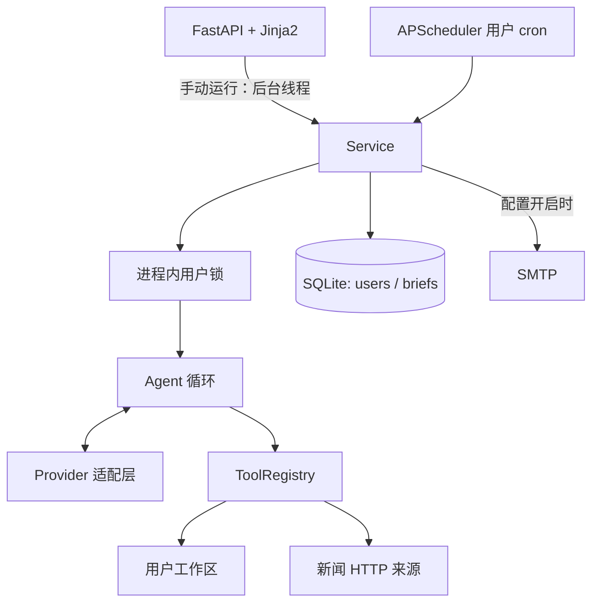
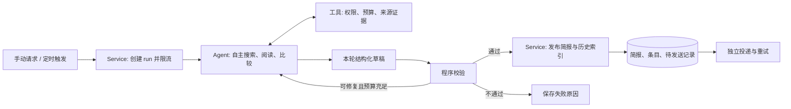

# 设计报告：每日 AI 新闻助手 Agent

> 2026-10-12 设计评审修订。本文区分「现状」与「建议实现」，后者尚未落到代码。问题证据与优先级见 [DESIGN_REVIEW.md](DESIGN_REVIEW.md)；此前已完成的代码修复见 [REVIEW.md](REVIEW.md)。仓库未提供原始题目，需求基线依据 README 和原设计整理，不能替代对原题的最终核对。

## 1. 产品目标与范围

为持续关注 AI 的开发者和研究者，每天提供一份与其关注点有关、能追溯原文、尽量不重复的简报。目标阅读时间为 3–5 分钟，这是产品目标，尚无用户测试数据。

核心问题是：**今天发生了什么值得我关注的变化，有什么依据，与我的关注点有什么关系？** 工具数量是实现条件，简报质量和交付可靠性才是验收结果。

保留手写单 Agent、Provider 适配层、SQLite、FastAPI + Jinja2，按以下顺序演进：

| 阶段 | 交付范围 | 完成标志 |
|---|---|---|
| A：可靠基线 | 内容契约、完整去重历史、任务与投递状态、时区、基础权限边界 | 能解释每次运行产出了什么、为何失败、是否推送 |
| B：创意扩展 | **事件更新雷达**：合并重复报道，指出旧事件的新进展，解释推荐理由 | 演示首次报道、重复报道、实质更新三种情况 |
| C：共享部署 | 登录与资源授权、网络出口隔离、恢复与运维 | 达到多用户访问边界要求后再开放服务 |

当前定位为本地、单进程演示。`run.sh` 实际监听 `0.0.0.0`，所以“仅本地使用”尚不是代码保证；阶段 A 应默认 loopback，开放访问前完成阶段 C。扩展优先服务于可信度、持续跟踪和稳定交付，无需立即引入多 Agent、向量库或任务队列。

## 2. 需求基线与现状

| 仓库记录的要求 | 已有实现 | 尚需验收或补齐 |
|---|---|---|
| 每日自动整理并推送 | `scheduler.py` 注册用户 cron；`service.py` 保存简报，可调用 SMTP | 依赖进程存活；推送需全局 SMTP 和用户开关同时开启，尚无独立投递状态 |
| 按话题、关键词订阅 | 偏好入库，运行时写入 `profile.json`，提示模型读取 | 尚无相关性评测与内容验收 |
| 模型自主寻找新闻 | `web_search` 支持 HN、arXiv、RSS、可选 Tavily；`fetch_url` 读取网页 | 来源在适配器范围内选择；真实模型换源能力需实测 |
| 至少 5 个工具 | `list_dir/read_file/search_content/write_file/bash`，另有两个新闻工具 | 有用时才调用，不以每次调用全部工具为目标 |
| 简单前端 | 创建身份、设偏好、手动运行、历史、trace | 邮箱识别不是认证；运行中状态与失败反馈不完整 |
| 工具顺序由 LLM 决定 | 循环不编码固定检索步骤，按模型调用分发 | Prompt 有“先读画像”等建议；假模型有脚本顺序，不能证明自主性 |
| Git、快速启动、密钥与建表 | Git 历史、`run.sh`、`.env.example`、ORM 和 `schema.sql` | 五分钟启动需在干净环境复验；依赖尚未锁定；`create_all` 不负责迁移 |

题目要求作为最低限度，新增能力仍需有明确的用户价值和可复验的结果。

## 3. 架构与职责

### 3.1 当前架构



目前 Agent 结束后才写 `Brief`，手动入口直接创建 daemon 线程。数据库没有排队、运行中或崩溃中断记录；应用内的锁不能支持多进程部署。

### 3.2 建议的职责边界



模型决定查什么、读什么、是否继续取证、如何组织信息；代码决定权限、预算、持久化和发布条件。**确定性校验、去重约束和发送逻辑不影响 Agent 自主选择工具。** 模型不能直接修改用户配置、发布账本或发邮件。

## 4. 简报内容契约（建议实现）

目前 `ok` 只表示模型正常结束，并且本轮确实写入非空文件。它不能证明新闻真实、及时、相关或不重复。建议模型通过 `write_file` 写本轮 `draft.json`，Service 校验后统一渲染 Markdown，保留文件工具作为 Agent 的工作界面。

每份简报允许 **0–10 条**，不为凑足 5 条添加低质量内容。条目包含标题、话题、1–2 句摘要、推荐理由和来源证据。以下只是字段示意，不是真实新闻；事件字段在阶段 B 启用：

```json
{
  "schema_version": 1,
  "items": [
    {
      "title": "项目 X 发布新的工具调用能力",
      "topic": "AI Agent",
      "summary": "概述来源明确支持的变化，不补写未披露的性能数字。",
      "why_it_matters": "你订阅了工具调用，此变化可能影响现有集成方式。",
      "evidence_ids": ["ev_001"],
      "event_id": null,
      "change_type": "new",
      "delta": null
    }
  ]
}
```

`run_id`、业务日期、URL 和证据记录由服务或工具产生，不能只信任模型填入的值。第一版校验规则：

1. JSON 结构、字段类型、条目数量和长度合法；每条引用属于本轮授权的证据集合。
2. 工具保存 `evidence_id/source/title/url/published_at/retrieved_at/excerpt/content_hash`；引用来自实际工具结果，不接受模型临时编出的链接。历史对照通过受控读取加入证据集合。
3. 日期未知时展示“日期未知”，不能写成“今日发布”；区分网页发布时间、事件发生时间和抓取时间。HN 提交时间不等于原文发布时间。
4. 默认检索近 48 小时以减少漏报，结合完整历史去重；超窗材料只作背景。未来日期或冲突时间须排查或降级，不能直接作为正常新闻。
5. 本轮重复 URL、历史已覆盖且没有新增事实的条目不发布。已完成必要的主题检索、来源正常但没有合格条目可记 `no_news`；全部来源失败记失败；部分失败且有合格条目可带覆盖提示发布。覆盖不足且无合格条目记 `failed/insufficient_coverage`，不能推断为没有新闻。
6. 返回具体校验错误供模型修订，最多两次，计入同一个预算；正文不得伪造引用来满足校验。

程序能验证可追溯性、结构和部分规则，**不能仅凭链接存在就证明摘要事实正确**。事实支持与推荐理由另用人工标注样本评估。仅拿到标题时不能扩写复杂事实；抓取失败应换源、降低表述强度或放弃该条。

## 5. Agent 循环、Prompt 与 Provider

### 5.1 已实现行为

- 内部消息保存 `assistant.tool_calls=[{id,name,arguments}]`、`tool.tool_call_id`；每轮交给 Provider，返回的工具调用逐个执行。
- 工具异常转 `ERROR: ...` 回传，模型可修改参数或换工具。注册表主要依赖 JSON 解析和函数调用错误，未完整执行 JSON Schema 验证。
- 默认最多 15 轮模型调用，倒数第二轮后提示收尾；同工具与相同**原始参数字符串**第三次出现时拒绝执行，但不会立即终止循环。
- 无工具调用时，`stop_reason=length` 记为 `length`，其他当前映射出的结束情况记 `model_finished`。另有 `max_steps`、`llm_error`。
- Service 还检查本次成功 `write_file` 的证据、目标路径、文件非空与修改时间；内容质量检查尚未实现。

建议解析参数并稳定序列化后做重复检测；显式保留 `unknown/refusal/content_filter` 等结束原因，不能默认视为正常完成。

### 5.2 Prompt 调整方向

现有 Prompt 说明目标文件、工作区、格式、查重、错误自纠与节约调用，并建议“先读画像”。准确表述是“循环没有固定业务步骤，Prompt 提供策略指导”。

建议增加内容契约、允许无新增、证据引用、不确定性与信任边界：网页、新闻标题、昵称、历史文件中的指令均是待处理数据，不能改变任务目标与工具权限。运行读取可信的偏好快照，系统检查必要条件是否满足，不能只靠模型自觉。Prompt 不能替代权限隔离。

### 5.3 Provider 适配

| 适配器 | 当前代码行为 |
|---|---|
| OpenAI 兼容（包括 Grok） | 使用 `openai` SDK，配置 `base_url/model` 并转换 tool calls；有适配器不代表每个模型均已实测 |
| Claude | system 单独传入；调用转 `tool_use`；连续结果合并成 user 的 `tool_result`；`ERROR` 前缀映射 `is_error` |
| Fake | 脚本化响应，用于流程与异常测试；不调用真实模型 API |

两种真实适配器配置 60 秒超时、2 次 SDK 重试、`temperature=0.3` 与 `max_tokens=4096`。实际接入模型需验证参数兼容性；消息转换单测不能替代真实调用。

**Fake 不等于全系统离线。** 当前 `demo_script` 仍通过 `web_search` 请求 HN；测试替换搜索工具才做到离线。建议增加固定新闻 fixture 的完整演示模式，并在 UI 标注模拟数据。

## 6. 工具契约与权限

| 工具 | 用途 | 当前边界与局限 |
|---|---|---|
| `list_dir` | 查看工作区 | 路径限定在用户工作区 |
| `read_file` | 读取画像、历史 | 读取后截断至约 2 万字符，注册表再限长；不是读取字节限制 |
| `search_content` | 子串查重 | 跳过外部软链，最多 50 条命中；只能字面匹配 |
| `write_file` | 写简报 | 可覆盖工作区内画像和旧简报，没有只读归档保证 |
| `bash` | 受限目录、文本操作 | 不经 shell；除只读类命令外允许 `mkdir`，并非完全只读 |
| `web_search` | 聚合候选 | 紧凑文本、串行来源；RSS 逐 feed 的异常目前静默跳过 |
| `fetch_url` | 获取网页文本 | 仅检查 http(s)，自动重定向；缺 SSRF 与响应字节限制 |

现有 `Sandbox.resolve()` 展开 `..`、软链并检查边界。文件工具将绝对路径重定位到工作区，`bash` 拒绝绝对路径和 `~`。这限制了工作区外访问，没有限制工作区内的写权限。

**建议阶段 A**：每轮构造独立工具权限，画像快照和已发布历史只读，模型仅能写 `staging/<run_id>/`；发布目录、去重索引、投递记录只有 Service 能写。同步限制 `mkdir` 等入口。历史视图只暴露已提交产物，失败草稿不作为去重依据。

`bash` 保留命令与选项白名单、禁止管道/重定向/命令拼接、`subprocess.run(argv)`、固定 cwd、文件参数校验和 10 秒超时；实际保留 `PATH` 和 `LANG`。这仍是应用层限制，存在检查与使用之间替换路径的风险，不能声称等同 OS 隔离。开放不可信用户或更强工具前增加独立执行器与资源/网络限制。

工具应增加运行时参数验证，包括 `days` 范围、来源枚举、查询长度和额外字段，并统一返回 `ok/data/error/retryable/truncated`。来源部分失败与工具整体失败分开表示，避免空结果掩盖故障。

## 7. 运行生命周期、存储与发布

### 7.1 现状

SQLite 存 `users/briefs`，正文在文件系统：

```text
data/workspaces/user_<id>/
  profile.json
  runs/YYYY-MM-DD/<run_id>.md   # 每次独立路径，尚可被工具覆盖
  briefs/YYYY-MM-DD.md         # 当天最后一次成功运行的副本
```

独立路径解决正常流程下历史正文互相覆盖的问题，但没有强制不可变；按日副本仍会丢失去重记忆。文件复制、数据库提交、邮件发送也没有跨系统事务。

### 7.2 最小数据模型演进（建议实现）

| 数据 | 关键字段或关系 | 责任 |
|---|---|---|
| `users`（扩展） | `timezone`、偏好版本 | 保存意图，运行使用快照 |
| `runs`（新增） | `run_id/user_id/trigger/idempotency_key/status/started_at/finished_at/error_code`，模型、Prompt 版本、预算和用量 | 请求受理即入库，失败也可见 |
| `briefs`（扩展） | 唯一 `run_id`、路径与内容 hash、`quality_status` | 关联已提交产物；旧数据标 legacy，不补造证据 |
| `brief_items`（新增） | `brief_id/canonical_url/evidence_ids`、标题、时间；阶段 B 加事件关联 | 完整发布历史和查重 |
| `deliveries`（新增） | `brief_id/channel/recipient/status/attempts/last_error`，组合唯一键 | 发送与生成解耦 |

首版证据可保存为运行关联的受控 JSON 文件。`schema.sql` 的默认值和空值约束并非与 ORM 严格等价；新增结构需要版本迁移，`create_all` 不能升级既有表。

### 7.3 状态与提交（建议实现）

运行状态：`queued → running → succeeded | no_news | failed | timed_out | interrupted`。内容覆盖另记 `complete/partial`，投递状态独立存储；模型 `stopped_reason` 仅作诊断字段。

1. 手动和定时入口统一验证用户、分配幂等键、创建 run，再交给有容量上限的执行池。同用户已有任务时返回该 run，容量满明确反馈。
2. 使用固定偏好快照、业务日期和预算。初始化、工具、模型、校验和落盘异常都更新该 run，不只记日志。
3. 校验通过后 Service 渲染正文，写临时文件并在同一文件系统内原子改名到发布目录，记录 hash；Agent 无权回写。
4. 在一个数据库事务内提交简报、条目索引、run 终态与待发送记录；提交后才投递。供文件工具读取的历史视图是可重建的派生数据。
5. 文件和数据库不是一个普通事务：文件已落盘而 DB 未提交时，恢复任务清理或重新校验孤立产物；已提交记录缺文件/hash 不符则标记损坏并停止发送。重启把遗留运行标 `interrupted`，先实现可见和可重试，再考虑续跑。

简单轮询即可展示状态，不必引入 WebSocket。用户看进度和失败原因，开发 trace 保持折叠。

## 8. 去重与事件更新雷达

### 8.1 修复去重基线（阶段 A）

当前模型搜 `briefs/`。同日第一次发布 A、第二次只发布 B 时，按日副本被覆盖；第三次再搜 A 会查不到。这是存储语义缺口，增加 embedding 不能解决。

最小修复是按成功运行追加只读历史，不覆盖旧记录；随后用 `brief_items` 建已发布 URL 索引。发布到 Web 即计入已覆盖历史；邮件失败由投递重试处理，不靠重新生成补发。

URL 规范化处理 fragment、主机大小写、默认端口和明确的跟踪参数；保留原始 URL 与语义查询参数，不删除全部 query，不统一改写路径大小写或 HTTP 协议。跳转后的 URL 必须来自受保护的抓取结果。

### 8.2 主创意：告诉用户“这件事后来怎样了”（阶段 B）

| 类型 | 示例（虚构） | 展示行为 |
|---|---|---|
| 新事件 | 项目 X 首次宣布工具调用功能 | 首次入选，解释与订阅的关系 |
| 重复报道 | 多家媒体转述同一公告，没有新增事实 | 合并来源，不重复占用条目 |
| 实质更新 | 次日正式开放功能，出现用量限制或更正 | 标记更新，说明新增事实，链接旧简报和新证据 |

先用规范 URL、项目/实体、版本号、时间窗和标题相似度产生少量疑似候选，再让模型比较证据，输出 `new/update/duplicate/uncertain` 及依据。不确定时保留或标记待核对，不凭相似标题强行合并；Service 校验事件关联和引用后写入。

最小事件记录含 `event_id`、实体/主题、首次发现时间、最近已发布摘要与证据。初期每用户建立事件记录，隐私与规模需求明确后再考虑共享事件库。

每条“一句推荐理由”必须对应显式订阅或关注项目。可增加“继续跟踪/不再关注”，但不凭一次点击自动重写偏好。自动学习延后。

**演示验收**：固定样本公告 A、转载 B、真实更新 C；首次生成 A，下次跳过 B、保留 C，指出新增点，能回看原文与上一份简报。以可验证的持续跟踪价值作为亮点。

## 9. 新闻来源与可信度

现有 HN、arXiv、RSS、Tavily 提供社区线索、论文、媒体/官方博客和搜索结果，它们不是等价证据。建议优先追溯公告、论文或仓库发布说明，再用报道补充背景；同一新闻稿的转载不算多方独立验证。

建议候选返回 ID、来源、标题、URL、日期和短摘录，完整证据由服务保存，模型按需精读；这些结构化证据尚未实现。补充记录各来源的成功、空结果、失败，包括 RSS 内部 feed 的失败。有 Tavily 时仍保留明确的回退选项；是否扩展检索由模型决定，记录实际动作。

先做运行内缓存。跨用户缓存仅限公开来源响应，按来源、规范查询、时间窗建键，不共享画像、私人历史和对话。等观察到重复请求的实际成本后，再扩大缓存范围。

## 10. 调度与投递

### 10.1 调度

现状：`BackgroundScheduler()` 没有显式时区或持久 job store；每用户 cron 设置 `coalesce=True/max_instances=1/misfire_grace_time=3600`，启动时重建任务，`date.today()` 使用宿主日期。没有每用户时区，也没有重启漏跑扫描。

APScheduler 默认内存 job store；误触发宽限处理调度器已知的错过执行，不能代替业务漏跑账本。此判断结合当前重建 cron 的实现与 [APScheduler 3.x 用户指南](https://apscheduler.readthedocs.io/en/3.x/userguide.html#missed-job-executions-and-coalescing)。

建议保存 IANA 时区（如 `Australia/Sydney`），事件时间以 UTC 存储，业务日期按用户时区计算。UI 将时间称为“每日开始生成时间”，发送会晚于它，不承诺准点到达。具体策略：

- 自动任务以用户、本地业务日期、任务类型为幂等键；同日最多一个逻辑 run，重试沿用 run 并记录 attempt。手动请求使用独立请求键。
- 启动时及运行期间周期扫描当天到期但未执行的任务，在配置的补跑窗口内补一次，超窗标记错过；不一次性补发停机多日的旧简报。
- 夏令时跳过的本地时刻在当天恢复后的首个有效时刻执行；重复时刻只执行一次。由补偿扫描和幂等键落实，不能仅依赖 cron 默认行为。
- 保留单 Web 进程、一个调度器，统一限制手动与自动任务并发；多副本或持续积压出现后再迁移独立 worker/队列。

### 10.2 推送是独立结果

当前全局 SMTP 关闭时 `send_email()` 静默返回；异常拼进 `stopped_reason`。`Brief.status=ok` 不能表示邮件发送成功。

建议投递状态为 `disabled/pending/sending/sent/failed/unknown`。用户开启邮件但服务未配置时明确显示未配置；SMTP 接受后才记 `sent`，仍不等于用户已收到或已读。失败只重试原简报，不重新调用模型。

`(brief_id, channel, recipient)` 唯一键避免普通重复发送任务；稳定 Message-ID 辅助追踪，不保证收件端去重。SMTP 已接受而进程在记账前崩溃时，结果记 `unknown`，不承诺 exactly-once；页面允许用户明确重发。手动生成默认仅预览，额外发送需显式操作；定时任务按订阅设置发送。以上均为建议行为。

## 11. 资源预算与失败降级

当前轮数、单次超时、返回文本长度限制不构成总预算。一轮可能有多个工具调用；事后截断不能限制已经下载或读入的字节数，也不能限制持续增长的消息历史。

建议以下初始配置，均为待压测起点：

| 预算 | 建议起点 | 执行位置 |
|---|---|---|
| 模型轮数 | 保留 15 轮，预留修订和收尾预算 | Agent |
| 总工具调用 | 30 次，重复和修订也计入 | ToolRegistry / RunContext |
| 总运行期限 | 180 秒，单次调用超时不超过剩余时间 | 模型、HTTP、子进程边界 |
| token | 可配置总预算；请求前估算，返回后累计，预留输出 | Agent / Provider |
| 抓取与文件 | 限制响应/读取字节、解压后体积、草稿大小 | 流式 HTTP、文件工具 |
| 并发 | 每用户 1 个，全局先限 2 个，队列有容量上限 | 统一执行池 |

计时变量不能强行终止同步调用或线程。可取消 I/O、受剩余期限约束的重试或进程级边界落实后，才能承诺硬截止；首版应如实说明执行方式。限额、超时和失败都需留下原因。

| 故障 | 建议结果 |
|---|---|
| 单来源失败 | 返回结构化错误，允许换源；有合格条目则带覆盖提示发布 |
| 全部来源失败 | `failed/source_unavailable`，不能显示“今天没有新闻” |
| 全部条目重复、检索正常 | `no_news`，可按用户设置跳过邮件 |
| 模型达到长度或预算上限 | 保存草稿与原因，未通过验收不自动发布 |
| 文件或 DB 提交失败 | 不发送，保留失败记录并可恢复 |
| 邮件失败 | 简报仍可查看，仅投递失败 |

成本先报告 token、调用次数、端到端耗时与来源失败率。金额根据实际模型价格和缓存计费规则换算，不预先承诺固定成本。先减少无效检索和上下文，再用测量结果决定摘要压缩或大小模型分工。

## 12. 安全与数据边界

已有路径检查、受限命令、Markdown 转 HTML 后的 `nh3` 白名单清理、推送时间验证，应保留。还需按入口补齐：

- **真实网页抓取前**：优先修复 SSRF。拒绝非公网目标、凭据型 URL 和不允许的端口；验证 IPv4/IPv6、DNS 解析与实际连接目标。默认禁用自动重定向，需要时逐跳重验，并用网络出口规则补强，不能只检查域名字符串。依据 [OWASP SSRF Prevention Cheat Sheet](https://cheatsheetseries.owasp.org/cheatsheets/Server_Side_Request_Forgery_Prevention_Cheat_Sheet.html)。
- **共享访问前**：认证、用户/简报/run 的对象授权、状态修改的 CSRF 防护、运行限流与收件邮箱验证。当前输入邮箱或知道 ID 就能访问资源，不能称为登录。
- **提示注入**：外部内容标记为数据，限制可写路径，固定发信收件人；不允许工具请求携带密钥或完整画像。以注入样本验证执行边界，而非只看模型口头拒绝。
- **隐私与 trace**：画像不写邮箱和密钥；当前包含姓名、订阅和语言，会进入模型上下文，产品说明须告知。搜索只发必要关键词；错误与 trace 脱敏，限制访问与保留时间。trace 展示工具动作和可见输出，不是模型内部推理。
- **清理与恢复**：删除用户时清理关联数据库、工作区和待发送项；证据只保留必要摘录与 hash，不默认长期保存全文。备份覆盖 DB 与发布文件，并验证恢复。

安全工作与使用场景绑定：固定 fixture 的本地演示可先完成内容和状态闭环；真实网络与共享用户访问分别要求对应入口先加固。

## 13. 测试、评测与验收

### 13.1 现有证据

`test_tools.py` 覆盖文件/命令边界、注册表报错和日期窗口；`test_agent.py` 覆盖脚本流程、错误回传、循环上限、假模型及消息转换；`test_web.py` 覆盖页面、HTML 清理、运行文件隔离和时间校验。

这些测试不证明真实模型质量、SMTP 投递或重启恢复。2026-10-12 评审环境没有项目 `.venv`，系统 Python 未安装 pytest，因此本次没有执行完整套件，也不沿用旧文档“29 个用例约 1 秒”的结果。本次用标准库和现有文件工具在临时目录复核了按日覆盖丢失去重记录、历史运行文件可被覆写两项行为。

### 13.2 计划验收

先准备约 20–30 条固定新闻样本，人工标注摘录、时间、相关性、事件归属与新增事实。该评测集尚未建立。

| 场景 | 必须验证的结果 |
|---|---|
| 正常个性化简报 | 符合显式偏好，每条来源对应实际工具证据 |
| 过期/未来/未知日期 | 不将无证据条目标为今日发布，未知时间可见 |
| 空候选/全部重复/全部来源失败 | 结果明确区分，不凑数 |
| 同日 A → B → A | 历史保留，第三次不重复发布 A |
| 同事件新进展 | 有新证据和 delta，关联旧简报；转载被合并 |
| 参数错误/来源超时/预算耗尽 | 可回传、降级或停止，终态可解释 |
| 同用户连点/进程重启 | 不并发重复生成，run 可见，中断可辨认 |
| 时区/午夜/DST/补跑 | 日期一致，自动任务同日只有一个逻辑 run |
| 邮件关闭/失败/结果不确定 | 状态准确，重试发送不重跑模型 |
| 注入/写旧历史/内网 URL | 在执行边界拒绝，不依赖模型配合 |

机械规则要求对应固定样例全部通过。内容评测报告相关条目占比、被引用证据支持的摘要事实占比、事件重复率、实质更新保留率，并给出分母、失败例与人工判定规则。覆盖率只能相对标注候选集计算，不能声称覆盖全网。

先测基线再定质量和时延门槛，不把任意百分比写成已达标成绩。至少保存一次真实 Provider 成功 trace 和一次来源故障 trace，记录模型、Prompt 版本、日期、偏好与用量，核验模型是否真的改变策略。

演示顺序：固定 fixture 离线跑通 → 事件更新案例 → 配置下一次调度并观察执行 → 投递状态及一次失败重试 → 展开真实 trace。SMTP 用测试收件箱验收，mock 发信不能替代实际交付证明。

## 14. 取舍与实施顺序

| 方案 | 当前决定 | 重新考虑的条件 |
|---|---|---|
| 手写循环 / Agent 框架 | 保留手写，便于观察调用和控制预算 | 需要复杂分支、长任务 checkpoint 或审批 |
| 自主 Agent / 固定流水线 | 检索阅读由模型选择，校验发布由代码执行 | 用同一评测集比较质量、时延、成本后调整自主范围 |
| 字面查重 / embedding | 先修历史、规范 URL、比较少量疑似事件 | 评测证明跨语言或改写误判成为主要问题 |
| APScheduler / 队列 | 单进程保留，统一受理与状态 | 多副本、持续积压、独立伸缩 |
| SQLite + 文件 / 其他存储 | 保留，补迁移、一致性与备份 | 测量发现并发写或容量瓶颈 |

固定流水线也能实现来源失败回退。选择 Agent 是为了适应不同话题和信息缺口、展示模型决策，不能以“流水线无法容错”为论据。

建议按可独立验收的增量推进，工期结合真实模型与部署环境估算：

1. **A1 内容与历史**：结构化草稿、来源证据、0 条/部分失败语义、完整发布历史、归档只读。
2. **A2 交付闭环**：持久 run、有界并发、时区与补跑、独立 deliveries、可见失败；真实联网前同步完成 SSRF 与资源限额。
3. **B1 一个亮点**：事件更新雷达、推荐理由、历史对照，用固定案例和真实 trace 证明价值。
4. **C1 开放服务**：认证、授权、隔离、清理和恢复测试完成后再开放多用户。飞书/Telegram、自动偏好学习、语义检索留作后续独立需求。

时间有限时，优先 A1/A2 和一个可验证的 B1 演示。以能否改善相关性、减少重复、解释新增信息决定扩展是否值得做。

## 15. 面试与设计答辩

- **为什么是 Agent？** 不同话题需要不同来源和取证深度，模型依据结果继续检索；展示实际轨迹，同时承认固定流程也能回退。
- **怎么证明成功？** 现状只证明本轮写入；目标是执行、内容验收、发布、投递分别有证据，一个 `ok` 不能包办。
- **最有价值的扩展？** 事件更新雷达：转载不重复推，实质变化有新增点、历史链接和来源证据。
- **自主性如何可控？** 模型选择工具与内容，系统限定权限、预算、发布条件，失败可以保留并解释。
- **当前边界？** 单进程演示，尚无鉴权、出口隔离、硬性总预算和真实模型质量基线；本文建议不代表代码已完成。
- **如何讲已有修复？** 参见 [REVIEW.md 的面试说明](REVIEW.md#面试怎么讲这次审查)，区分已修复代码问题与本次设计缺口。
