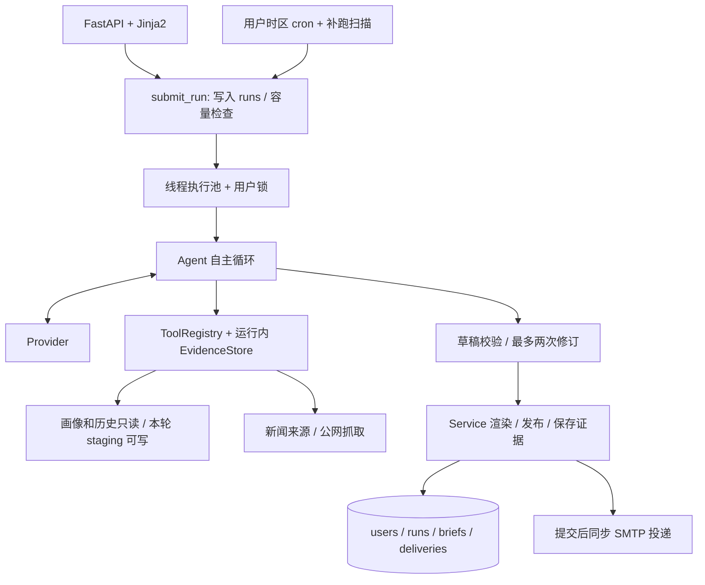

# 设计报告：每日 AI 新闻助手 Agent

> 核对日期：2026-10-13（Australia/Sydney）；代码基线：`f8f815b`。本文描述当前实现，并明确标注未实现的目标。当前缺口与验收建议见 [DESIGN_REVIEW.md](DESIGN_REVIEW.md)，2026-10-11 的八项历史修复见 [REVIEW.md](REVIEW.md)。仓库未提供原始题目，需求基线依据 README 整理，不能替代对原题的最终核对。

## 1. 产品目标与范围

为持续关注 AI 的开发者和研究者，每天提供与订阅话题有关、能追溯来源、尽量不重复的简报。目标阅读时间为 3–5 分钟，尚无用户评测证明已达成。

保留手写单 Agent、Provider 适配层、SQLite、FastAPI + Jinja2。模型决定如何检索和阅读，程序控制工具权限、草稿校验、发布和投递。当前定位是本机、单 Web 进程演示；`run.sh` 默认监听 `127.0.0.1`，可由 `HOST` 修改。进程内锁和启动恢复逻辑不支持多进程共享运行。

| 阶段 | 当前完成部分 | 尚未完成 |
|---|---|---|
| A：可靠基线 | 结构化草稿与证据 ID、追加式历史、持久 run、有界执行池、用户时区、补跑扫描、投递记录、基础网络限制 | 来源覆盖与无新闻判定、内容时效验收、发布一致性恢复、投递并发控制与恢复 |
| B：事件更新雷达 | 每条推荐理由；`change_type/update/delta` 字段及基础校验 | 事件归并、实质更新核验、旧简报关联、固定事件评测集 |
| C：共享部署 | 默认 loopback、路径和命令限制、HTML 清理 | 登录与对象授权、CSRF、出口隔离、版本迁移、备份与清理 |

阶段 A 已有主要实现，但不能标为整体完成；阶段 B/C 仍是扩展目标。

## 2. 需求基线与现状

| 仓库记录的要求 | 当前实现 | 验收限制 |
|---|---|---|
| 每日自动整理并推送 | 用户时区 cron、补跑扫描；简报落盘；可选 SMTP 投递与手动重发 | 依赖进程存活；没有自动投递 worker；失败的定时 run 不自动重试 |
| 话题、关键词订阅 | 偏好入库，执行时同步 `profile.json`；模型读取画像 | 相关性和推荐理由主要靠 Prompt，未建立内容评测集 |
| 模型自主找新闻 | HN、arXiv、RSS、可选 Tavily 搜索；`fetch_url` 获取正文 | 真实模型的换源与内容质量需独立实测 |
| 至少 5 个工具 | 五个文件/命令工具加两个新闻工具 | 不要求每次调用全部工具 |
| 简单前端 | 身份、偏好、手动运行、最近运行、历史、投递与 trace | 邮箱不是认证；页面静态，状态更新需刷新或调用状态接口 |
| LLM 决定工具顺序 | 循环分发模型返回的工具调用；无固定检索流水线 | Prompt 建议先读画像；Fake 使用脚本顺序，不能证明自主性 |
| 快速启动、配置、建表 | `run.sh`、`.env.example`、`make check-llm`、ORM 与 `schema.sql` | 干净环境五分钟启动未复验；依赖未锁定；补列不是完整迁移 |

## 3. 架构与职责



`submit_run` 先提交 `Run` 再交给线程池。Service 执行 Agent、校验本轮写入、渲染正文并保存 `Brief`；有邮件订阅时同时创建 `Delivery`，提交后同步调用 `deliver`，随后 `_execute` 更新 run 终态。投递与生成有独立记录和重发入口，但尚未在执行层拆成独立 worker，也没有文件与数据库的一致性恢复流程。

## 4. 简报内容契约

模型写 `staging/<run_id>/draft.json`，不直接发布 Markdown。字段示例如下，内容为虚构：

```json
{
  "schema_version": 1,
  "note": null,
  "items": [{
    "title": "项目 X 发布新的工具调用能力",
    "topic": "AI Agent",
    "summary": "仅概述来源明确支持的变化。",
    "why_it_matters": "此变化与你订阅的工具调用话题有关。",
    "evidence_ids": ["ev_001"],
    "event_id": null,
    "change_type": "new",
    "delta": null
  }]
}
```

[brief.py](../app/brief.py) 校验 0–10 条、四个必填文本字段及长度、最多五个本轮证据 ID、未知字段、必填文本中的 URL、同轮来源 URL 重复、历史来源 URL，以及 `update` 的非空 `delta`。`change_type` 接受 `new/update/uncertain`，`duplicate` 必须删除。全部引用 URL 都已发布时，普通条目被拒绝；增加一个新 URL 或声明 `update` 可以通过该历史规则，不能据此证明事实有更新。

证据由工具分配，保存 `evidence_id/tool/source/title/url/published_at/retrieved_at/excerpt/content_hash`。摘录最多 500 字符；`content_hash` 是 URL、标题与截断摘录的 SHA-256 前 16 位，不是完整页面或已发布正文的 hash。搜索证据来自返回文本的解析；抓取可继承同 URL 搜索结果的日期。HN 时间是社区提交时间，未知日期显示“日期未知”；抓取证据目前记录请求 URL，不保存重定向后的最终 URL。

Service 要求本轮 trace 中有成功写入目标草稿的 `write_file`，且草稿非空、修改时间属于本轮；错误最多回传修订两次，共用轮数和调用预算。通过后 Service 转义模型文本、用证据库提供链接并渲染 Markdown，旁存草稿和证据 JSON。

尚未落实的质量规则：

- 空草稿直接记 `no_news`，不要求成功检索；全部来源失败与确实无新增尚未可靠区分。
- 没有 `complete/partial` 覆盖状态、必要话题覆盖检查或结构化来源健康账本。
- 默认检索近两天，但校验器不执行发布日期窗口、未来日期、事实支持、订阅相关性或语言检查。
- `update/delta/event_id` 只有基础字段规则，没有事件账本和新增事实验证；草稿的所有字段类型也尚未严格验证。

程序证明引用属于本轮工具结果，不能证明摘要事实正确。来源只有标题时，应收缩表述或继续取证；这目前主要由 Prompt 指导。

## 5. Agent、Prompt 与 Provider

默认最多 15 轮模型调用、30 次工具调用、180 秒软期限。调用计数包含重复、失败与修订；超预算会拒绝工具执行，期限只在每轮/每次工具调用前检查，不能中断同步 I/O，最终模型响应回来后也未再次检查。参数解析后稳定序列化判重，同一调用第三次拒绝执行；`fetch_url` 额外规范 URL 并忽略末尾斜杠。本轮失败的同一网络调用缓存错误，连续三轮工具全失败提示收尾，五轮停止。

Prompt 说明草稿、画像、证据、历史、外部内容不可信和节约调用，并建议先读画像。工具异常回传 `ERROR`；注册表未完整执行 JSON Schema。无工具调用时 `length` 单列，其他结束结果视作 `model_finished` 再进入草稿校验；拒绝、过滤等结束原因尚未显式保留。

| Provider | 当前行为 |
|---|---|
| OpenAI 兼容 / Grok | `openai` SDK；配置基础地址和模型；转换 tool calls |
| Claude | 独立 system；转换 `tool_use/tool_result`；合并连续工具结果；映射错误标志 |
| Fake | 脚本化模型响应；演示仍请求 HN，完整离线需 mock 新闻工具 |

真实适配器默认单请求超时 60 秒、SDK 重试两次，发送 `temperature=0.3/max_tokens=4096`。DeepSeek 官方主机使用关闭思考的扩展参数，其他地址不自动附加。模型名和参数兼容性以实际服务与真实检查为准。

`make check-llm` 用一次小请求验证配置、鉴权和工具调用，关闭重试并使用 20 秒超时；不搜索新闻或发邮件。它不能代替完整 Agent、多轮工具与质量验收。`.env` 不热加载，进程环境优先，修改后须重启。

## 6. 工具契约与权限

| 工具 | 当前限制 | 剩余边界 |
|---|---|---|
| `list_dir` | 工作区路径检查 | 没有全局目录规模限额 |
| `read_file` | 工作区；返回最多约 2 万字符 | 先读完整文件，非读取字节限额 |
| `search_content` | 跳过工作区外软链；最多 50 条命中 | 字面匹配；无总扫描字节/文件限额 |
| `write_file` | 仅本轮 staging 可写 | 未设文件大小或磁盘总配额 |
| `bash` | 命令/选项白名单、无 shell、路径检查、10 秒超时；`mkdir` 仅 staging | 保留 `PATH/LANG`；应用层检查存在 TOCTOU 风险 |
| `web_search` | 日期下界过滤；RSS 查询匹配；feed 错误回传 | 来源串行，错误为文本；无总下载限额或完整参数验证 |
| `fetch_url` | 公网/DNS/端口/凭据检查；逐跳重验；流式读取到约 2 MB 后停止，最终正文最多 2 MB | 原始累计可超一个 chunk；DNS 检查与连接分离；无最终 URL 记录 |

文件工具将绝对路径重定位到工作区，`bash` 拒绝绝对路径和 `~`；resolve 检查 `..` 和软链。Service 每轮只授予 `staging/<run_id>/` 写权限，模型不能通过这些工具覆盖画像、已发布 `runs/` 或 `briefs/`。这不等于宿主文件系统只读或 OS 隔离。

注册表执行后最多返回 6000 字符，trace 工具输出最多存 2000 字符。截断不是下载、文件读取或上下文总预算。工具 schema 告诉模型参数形式，执行层还需验证类型、枚举、范围、查询长度及额外字段。

## 7. 生命周期、存储与发布

```text
data/workspaces/user_<id>/
  profile.json
  staging/<run_id>/draft.json
  runs/YYYY-MM-DD/<run_id>.md
  runs/YYYY-MM-DD/<run_id>.draft.json
  runs/YYYY-MM-DD/<run_id>.evidence.json
  briefs/YYYY-MM-DD/<run_id>.md
```

成功结果按 run 追加历史，同日 A → B → A 的普通重复可查到 A。失败草稿留在 staging。校验通过的空草稿也保存正文、证据和 `Brief`，状态为 `no_news`。

| 数据表 | 当前内容 | 未完成的数据能力 |
|---|---|---|
| `users` | 偏好、语言、开始时间、IANA 时区、邮件开关 | 偏好版本与受理时快照 |
| `runs` | 唯一 run ID、用户、触发方式、可选唯一幂等键、状态、错误、时间、简报 ID | attempt、模型/Prompt 版本、UTC 时间规范 |
| `briefs` | 用户、业务日期、正文路径、run ID、结果、步数、token、trace | 正文 hash、质量/覆盖状态、唯一 run 关联约束 |
| `deliveries` | 简报、渠道、收件人、状态、尝试数、错误、Message-ID；组合唯一键 | 原子领取、自动恢复与重试调度 |

没有 `brief_items` 或事件表。证据和草稿保存在文件中；历史 URL 每轮从 `briefs/**/*.md` 重新读取提取，尚无数据库索引。

当前状态：

- Run：`queued → running → succeeded | no_news | failed`；启动时遗留活动 run 标 `interrupted`。期限耗尽归入 `failed`，诊断原因是 `deadline`，没有 `timed_out` 状态。
- Brief：`ok/no_news/failed`。初始化等早期异常可能只有失败 Run，没有 Brief。
- Delivery：`not_configured/pending/sending/sent/failed/unknown`；邮件关闭时不创建记录，页面显示 `disabled`。重启只把 `sending` 标 `unknown`。

执行时读取当时的用户偏好，受理时没有冻结快照。默认每用户一个活动任务、全局两个执行线程和十个 queued 记录；容量拒绝也保存失败 Run。线程池与用户锁均在进程内。

发布对正文和历史文件分别执行临时文件改名，每个文件单独原子替换；证据侧文件另写。Brief 与待投递记录在同一 DB 事务提交，Run 终态后续独立提交。这不是文件、简报、历史和 Run 的整体原子事务。未提交历史/孤立文件、正文丢失或损坏目前没有恢复扫描；启动恢复也不会续跑。

`init_db()` 建缺失表并补旧表缺失列，不改类型、不补完整约束或索引。`schema.sql` 与 ORM 的默认值/空值约束并非严格等价；正式升级需版本迁移。

## 8. 去重与事件更新雷达

当前两层去重：模型用文件搜索检查历史，Service 独立提取历史规范 URL 并校验。URL 规范化去 fragment、主机大小写、默认端口和明确跟踪参数，保留语义 query、协议和路径大小写。同轮相同来源须合并；全部引用来源 URL 已发布的普通条目被拒绝，声明更新且给 delta 可通过。

这解决了历史按日覆盖和普通同 URL 重发，但尚不能判断不同 URL 是否为同一事件，也不能核实同 URL 的 delta 是否只是改写。一个条目混入新 URL 也可通过现有历史校验。

阶段 B 目标：从规范 URL、实体、版本与时间生成疑似事件，再让模型比较证据，Service 校验后记录事件类型与旧简报关系。先按用户建立事件记录，暂不引入共享事件库或 embedding。

验收使用公告 A、无新增转载 B、实质更新 C：首次发布 A；下次合并/跳过 B，保留 C，说明新增事实并链接旧简报。当前没有该事件账本、样本集或完整验收结果。

## 9. 来源与可信度

HN、arXiv、RSS、Tavily 分别提供社区线索、论文、媒体/博客和搜索结果，证据强度不同。优先追溯公告、论文或发布说明仍是内容策略；转载不能自动算独立验证。

各来源及 RSS 单 feed 异常现在会回传；未配置 Tavily 时 schema 隐藏该来源，显式请求也说明跳过。RSS 有查询词匹配和 `unmatched` 回退提示；arXiv 使用 HTTPS 并限制重定向域名。聚合结果仍是文本，没有统一成功/空结果/失败统计；配置 Tavily 后默认只搜 Tavily，换源由模型决定。

已有运行内失败调用缓存，尚无一般成功响应缓存或跨运行缓存。后续跨用户缓存应仅缓存公开来源，不共享画像或私人历史。

## 10. 调度与投递

### 10.1 调度

`BackgroundScheduler(timezone="UTC")` 使用内存 job store，启动从用户配置重建 cron。用户 cron 使用其 IANA 时区、`coalesce=True/max_instances=1/misfire_grace_time=3600`；`catch_up` 启动立即触发并每十分钟扫描。业务日期按用户时区计算，定时幂等键为 `sched:<user_id>:<day>`。

补跑只检查用户本地当天、到期且仍在 `CATCHUP_HOURS` 窗口内、没有对应定时幂等键的任务。DST 不存在的时刻通过有效时刻检查顺延，重复执行靠幂等键限制。UI 将时间称为“每日开始生成时间”，不是邮件到达时间。

剩余限制：不扫描前一业务日，即使跨午夜后仍在补跑时限；没有超窗漏跑账本；同日失败、容量拒绝或中断的幂等键会阻止自动重新尝试。DB 事件时间仍使用宿主 `datetime.now()` 的无时区值，不能称为统一 UTC 存储。时区/DST 单测不等于真实长时间调度验收。

### 10.2 投递

仅非空 `ok` 简报且用户开启邮件时创建 Delivery。SMTP 关闭时显示 `not_configured`；开启时提交后立即发送，SMTP 调用无异常才记 `sent`，不表示收件人已收到或已读。`no_news` 不发邮件。

失败可通过 `/deliveries/<id>/retry` 重发原正文，顺序调用对 `sent` 会跳过；启动时 `sending` 标 `unknown`，页面允许明确重发。不承诺 exactly-once。手动生成也按邮件订阅发送，没有“默认仅预览”或独立发送开关。

发送同步占用生成线程，Run 在投递返回后才更新终态。没有 pending 自动恢复、定时退避或原子领取；并发调用同一记录可能重复发送。页面为 `failed/unknown/pending` 提供重发按钮，`not_configured` 补配 SMTP 后没有对应按钮。独立数据模型已实现，可靠独立执行仍需补齐。

## 11. 预算与失败降级

| 控制 | 当前实现 | 待补 |
|---|---|---|
| 模型轮数 / 工具次数 | 15 轮 / 30 次；修订和重复共用预算 | 预留可执行的收尾写入预算 |
| 运行时间 | 180 秒软期限；模型 60 秒、新闻 HTTP 15 秒、bash 10 秒单次限制 | 按剩余期限限制调用与重试；可取消执行 |
| token | Brief 累计输入/输出用量 | 总 token 上限、上下文压缩与版本记录 |
| 抓取 / 文件 | `fetch_url` 最终正文 2 MB，原始读取为近似限额；返回文本截断 | 搜索源下载、读文件、草稿和磁盘配额 |
| 并发 / 排队 | 进程内用户锁；两线程；十个 queued | 多进程协调、拒绝/失败任务重试、执行池清理 |

可见诊断包含 `llm_error/length/max_steps/validation_failed/deadline/tool_failures`；工具异常回传，推送失败独立记录。尚未实现 `source_unavailable/insufficient_coverage` 内容结果或部分覆盖提示。金额不预先承诺，需按实际服务计费和测量结果计算。

## 12. 安全与数据边界

已实现路径 resolve、staging 写权限、受限命令、Markdown 转 HTML 后 `nh3` 清理、开始时间与 IANA 时区校验，以及 `fetch_url` 公网检查、逐跳重验与体积限制。

共享访问前仍需登录、用户/简报/run/投递的对象授权、CSRF、收件邮箱验证和运行限流。当前首页列出身份，知道 ID 就可访问或修改资源；默认 loopback 是部署边界，不是认证。

DNS 检查与实际连接之间仍有窗口；RSS 等固定来源下载也未共用完整抓取限额。Prompt 将网页、标题和历史标为数据，权限阻止写归档，但公网抓取和查询仍可能携带模型上下文中的个人信息，尚无专门外发数据策略或注入评测。

画像不含邮箱和密钥，但姓名、话题、关键词、语言会进入模型上下文。正式产品需说明数据去向，并限制 trace 的访问、脱敏与保留时间。当前没有用户删除和关联文件清理、完整备份恢复或 OS 执行隔离。trace 是模型可见文本和工具动作，不是内部推理。

## 13. 测试、评测与验收

2026-10-13 在当前 `.venv` 执行 `.venv/bin/pytest -q`：**155 passed in 1.57s**。这是本次离线回归结果，历史报告的“没有 `.venv`、未运行测试”只适用于当时环境。

| 测试文件 | 已覆盖 |
|---|---|
| `test_tools.py` | 路径/命令/软链、日期下界、SSRF/重定向、压缩/体积限制、RSS 匹配、arXiv/Tavily、glob |
| `test_agent.py` | 假模型、消息转换、错误回传、规范参数判重、预算、失败缓存/连续失败 |
| `test_web.py` | 页面/XSS、本轮写入、历史隔离、归档只读、草稿修订、run/恢复/容量、时区/DST、基本投递状态 |
| `test_brief.py` / `test_evidence.py` | 草稿和引用、URL 去重、渲染转义、证据 ID、日期继承 |
| `test_provider_config.py` / `test_llm_check.py` | 配置错误、模型参数保留、官方端点扩展参数、工具检查与错误脱敏 |

本次未调用真实模型、新闻源或 SMTP，未做干净安装、真实调度、实际进程崩溃恢复或压力测试；测试通过不能证明这些场景已通过，也不代表报告中的缺口已解决。当前问题的临时离线复核见评审报告，并未添加为永久回归测试。

下一轮先为全部来源失败却写空草稿、未来日期、伪造更新、发布后 DB 失败、并发重发、pending 重启和定时失败补跑建立反例。随后准备 20–30 条人工标注样本，评估相关性、事实支持、事件重复和实质更新保留率，记录分母与失败例；该样本集尚未建立。

真实验收需保存一次完整 Provider 成功运行和一次来源故障运行，记录模型、Prompt 版本、偏好与用量；SMTP 用测试收件箱，调度观察真实触发。接口检查成功只证明一次小请求可用。

## 14. 取舍与实施顺序

1. 补齐来源健康、覆盖与可靠 `no_news`、日期和字段校验；保留现有结构化草稿和追加历史。
2. 补齐投递原子领取、pending 恢复、文件/DB 对账、定时失败重试；统一时间与版本迁移。
3. 验收事件更新雷达，用公告/转载/更新固定案例证明价值；不把字段存在写成完整功能。
4. 按部署需求实施认证、授权、网络/执行隔离、清理与恢复；多副本出现后再引入独立 worker/队列。

保留手写循环便于观察和控制；固定流水线也可以容错，是否扩大自主范围应由同一评测集的质量、时延和成本决定。先完善可信度和交付闭环，再考虑 embedding、多 Agent、自动偏好学习或更多推送渠道。
